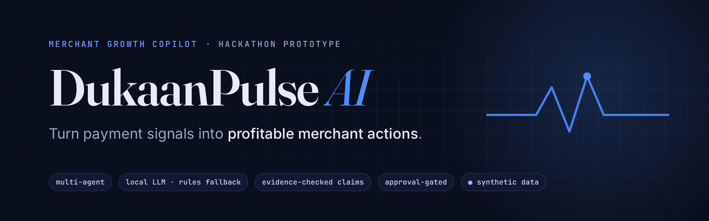
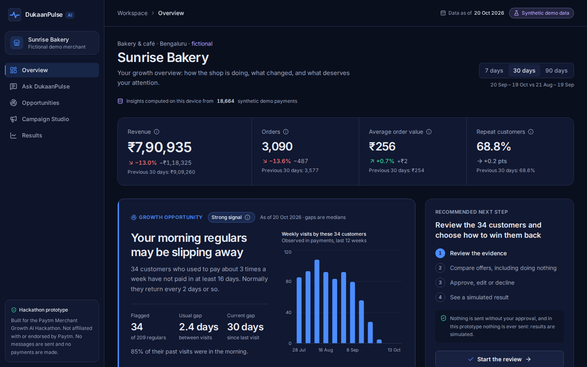
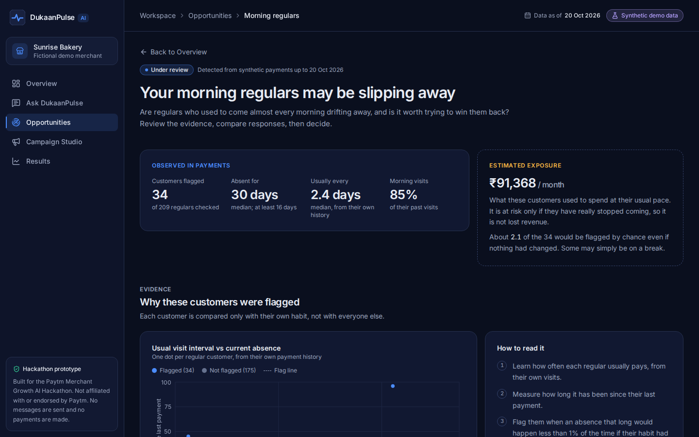
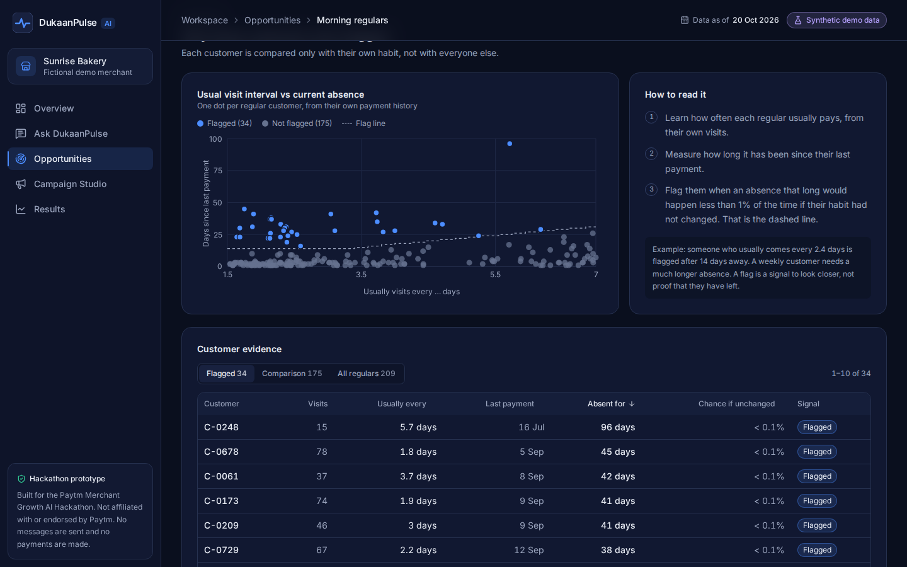
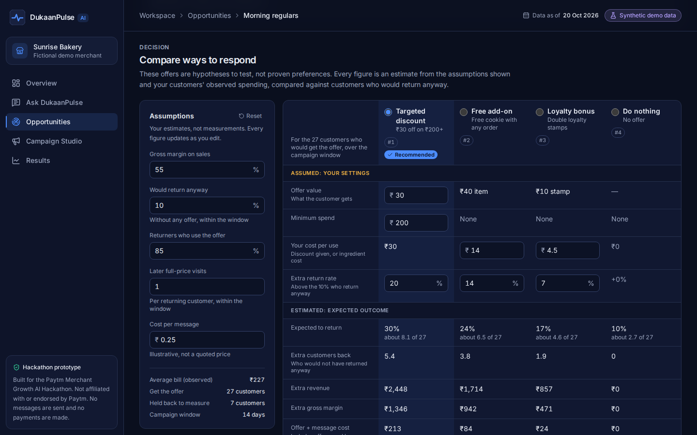
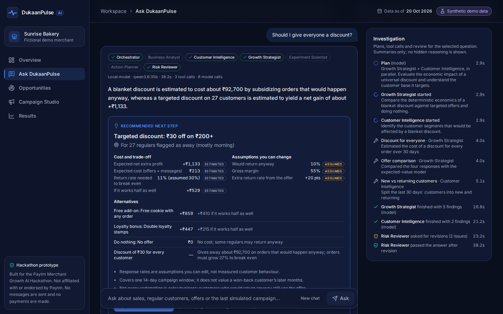
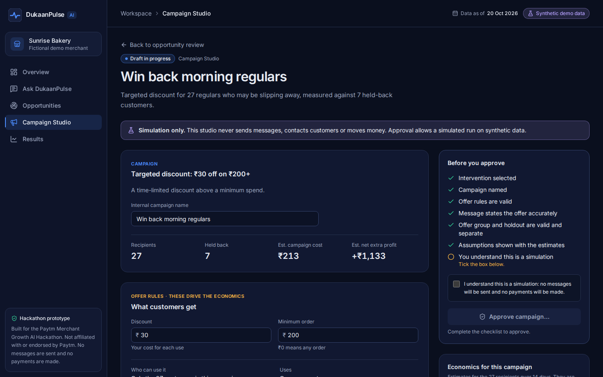
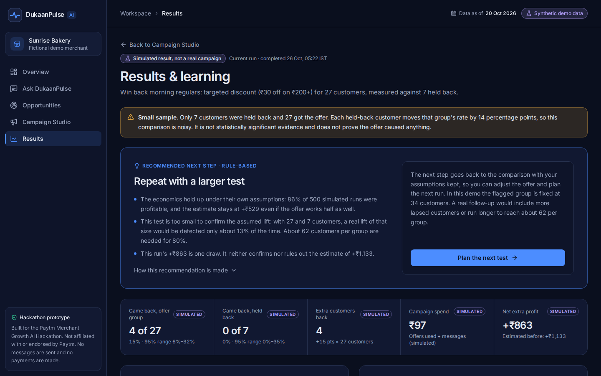
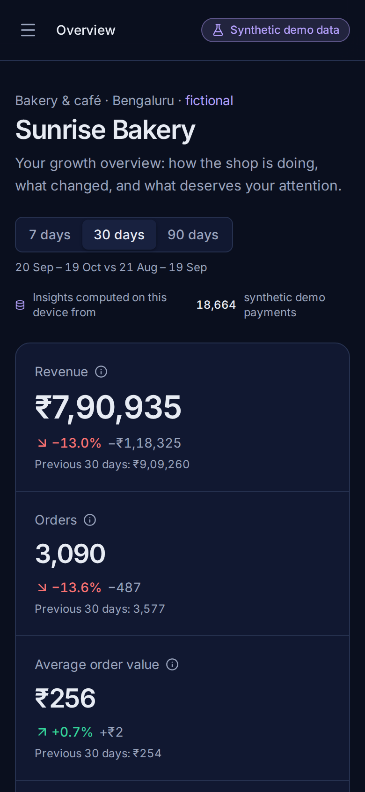
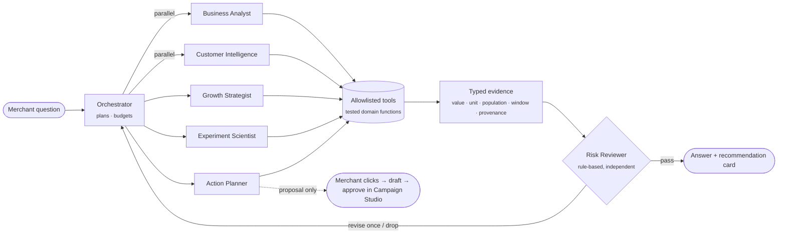

<p align="center">
  
</p>

<p align="center">
  
  
  
  
  
  
</p>

<p align="center">
  <b>An AI growth copilot for small Indian merchants.</b><br>
  <sub>It spots a business opportunity in payment data, explains the evidence, compares responses (including doing nothing),
  drafts a campaign for the merchant to approve, simulates it, and measures the result against a holdout.</sub>
</p>

> [!IMPORTANT]
> **Hackathon prototype on synthetic data.** "Sunrise Bakery", its customers and every payment are generated by a
> seeded simulator. No real merchant or Paytm data is used. Nothing is ever sent and no money ever moves. Built for the
> Paytm Merchant Growth AI Hackathon; **not affiliated with or endorsed by Paytm.**

---

## The journey

<table>
  <tr>
    <td width="50%"><br>
      <sub><b>1 · Overview.</b> Revenue, orders, average bill and repeat customers vs the previous period, plus the opportunity the detector found.</sub></td>
    <td width="50%"><br>
      <sub><b>2 · Opportunity Explorer.</b> Observed facts are kept apart from the estimated exposure, which comes with its caveats.</sub></td>
  </tr>
  <tr>
    <td><br>
      <sub><b>3 · Evidence.</b> Every regular compared with their <i>own</i> habit; the dashed line is the detector's actual rule.</sub></td>
    <td><br>
      <sub><b>4 · Compare responses.</b> Discount, free add-on, loyalty bonus or do nothing, with editable, validated assumptions.</sub></td>
  </tr>
  <tr>
    <td><br>
      <sub><b>5 · Ask DukaanPulse.</b> Specialist agents investigate in parallel on a local model; a reviewer checks every claim before you see it.</sub></td>
    <td><br>
      <sub><b>6 · Campaign Studio.</b> Edit the offer and message, check the economics, then approve deliberately. Simulation only.</sub></td>
  </tr>
  <tr>
    <td><br>
      <sub><b>7 · Results &amp; learning.</b> Simulated outcome vs the frozen estimate, honest uncertainty, and a rule-based next step.</sub></td>
    <td align="center"><br>
      <sub><b>Responsive.</b> Works from 390 px phones to wide desktops.</sub></td>
  </tr>
</table>

---

## Features

<table>
  <tr>
    <td width="33%" valign="top">
      <h4>📈&nbsp; Command center</h4>
      <sub>KPIs with comparisons and denominators, a revenue trend with a table view, time-of-day and customer-mix breakdowns, and 7 / 30 / 90-day ranges.</sub>
    </td>
    <td width="33%" valign="top">
      <h4>🔎&nbsp; Lapse detection</h4>
      <sub>Each regular's visit rate is learned from their own history; an absence is flagged only when it is improbable for them. The expected number of chance flags is always reported.</sub>
    </td>
    <td width="33%" valign="top">
      <h4>⚖️&nbsp; Decision support</h4>
      <sub>Expected-value economics for four responses, using an explicit baseline (people who return anyway), break-even, a half-uplift downside check and a documented ranking rule.</sub>
    </td>
  </tr>
  <tr>
    <td valign="top">
      <h4>✅&nbsp; Approval gate</h4>
      <sub>A state machine binds approval to the exact configuration. Message terms are validated against the offer, and nothing runs without the merchant.</sub>
    </td>
    <td valign="top">
      <h4>🧪&nbsp; Honest measurement</h4>
      <sub>A seeded simulation with a holdout group, Wilson ranges, power and sample size, and a 500-run spread. Small samples are flagged, not dressed up.</sub>
    </td>
    <td valign="top">
      <h4>🤖&nbsp; Multi-agent Q&amp;A</h4>
      <sub>An orchestrator and five specialists use allowlisted tools, run in parallel, and stay within budgets. A labelled rule-based engine takes over if the model fails.</sub>
    </td>
  </tr>
  <tr>
    <td valign="top">
      <h4>🛡️&nbsp; Claim verification</h4>
      <sub>Numbers can only come from tools. A deterministic reviewer checks segment, period, direction, evidence type, causation and recommendation consistency for every claim.</sub>
    </td>
    <td valign="top">
      <h4>🎯&nbsp; Merchant-ready answers</h4>
      <sub>A recommendation card shows the action, target, cost, assumptions and alternatives, or says plainly that there isn't enough evidence yet.</sub>
    </td>
    <td valign="top">
      <h4>🔒&nbsp; Private by design</h4>
      <sub>Runs entirely on one machine: browser app plus a local model through a two-route endpoint. No API keys, no external calls.</sub>
    </td>
  </tr>
</table>

---

## How it works



- **Agents never write numbers.** They reference tool metrics as `{{callId.metric}}`, and the app formats them.
- **Offer amounts and time windows come from the merchant's words.** Amounts or windows a model invents are discarded.
- **The reviewer has no model and no tools.** It reads only claims and evidence, so it can't be talked out of a rule.
- **Agents can only propose.** Approval, simulation and results stay in the existing, tested workflow.

---

## Quick start

```bash
git clone https://github.com/Thebinary110/dukaanpulse-ai.git
cd dukaanpulse-ai
npm ci
npm run build && npm run preview          # → http://localhost:4173
```

**Optional local model.** The app works fully without it, using the rule-based engine.

```bash
ollama pull qwen3.6:35b                   # or set DUKAANPULSE_MODEL to another installed model
npm run warmup                            # loads the model and checks readiness
```

| Variable | Default | Purpose |
|---|---|---|
| `DUKAANPULSE_MODEL` | `qwen3.6:35b` | Model the server endpoint uses (fixed server-side) |
| `DUKAANPULSE_OLLAMA_URL` | `http://127.0.0.1:11434` | Where Ollama runs |
| `DUKAANPULSE_KEEP_ALIVE` | `2h` | How long Ollama keeps the model loaded between questions |

Presenting? See the **[demo runbook](docs/DEMO.md)** for the rehearsed journey, timings and the rules-only fallback
(`/ask?engine=rules`).

---

## Quality and evaluation

| Check | Result |
|---|---|
| Unit tests (domain, state machine, agents, reviewer, adversarial suite) | **414 passing** |
| Browser tests (Playwright, every screen and the full workflow) | **73 passing**, three runs in a row |
| Adversarial suite: 10 attack types × model-assisted and rule-based paths | 12/12 bad claims rejected, 9/9 correct claims kept |
| Live evaluation on the local model (`npm run eval:agents`) | **12/12 cases**; every claim shown grounded and correctly labelled; about 24 s average, 39 s maximum |

> [!NOTE]
> **What these results do and don't show.** They measure whether answers are grounded in the tool evidence, scoped to
> the right customers and period, numerically consistent, honestly labelled, and unable to take actions, all on
> **synthetic data**. They do **not** show that any recommendation would increase a real merchant's revenue. That
> would need a real, randomized test with far more customers than this demo has (about 62 per group to detect the
> assumed lift, against 27 vs 7 here).

---

## Tech stack

<table>
  <tr><td><b>App</b></td><td>React 19 · TypeScript (strict) · Vite 8 · Tailwind CSS 4 · Radix UI · Recharts · React Router</td></tr>
  <tr><td><b>Domain</b></td><td>Pure, seeded TypeScript: generator, detector, economics, simulator, statistics. No <code>Math.random()</code>.</td></tr>
  <tr><td><b>Agents</b></td><td>Custom bounded orchestrator, typed tools, deterministic semantic reviewer, Ollama (<code>qwen3.6:35b</code>) via a restricted Vite server endpoint</td></tr>
  <tr><td><b>Testing</b></td><td>Vitest · Playwright · axe accessibility checks · scripted-model and live-model evaluation</td></tr>
</table>

<details>
<summary><b>Project structure</b></summary>

```
src/
  domain/        seeded data generator, metrics, lapse detector, economics, simulator, statistics, results
  state/         scenario state machine (approval gate), validated session persistence, learning history
  agents/        tools, agent definitions, orchestrator, rules engine, model client,
                 semantic reviewer, recommendation builder, evaluation suites
  screens/       Overview · Ask DukaanPulse · Opportunities · Campaign Studio · Results
  components/    shared UI
server/          restricted model endpoint for the Vite dev/preview server
scripts/         warmup.mjs (demo readiness), readme-assets.mjs (banner + screenshots)
e2e/             Playwright tests
docs/            TECHNICAL.md (formulas, rules, decisions) · DEMO.md (runbook) · screenshots
```
</details>

<details>
<summary><b>Commands</b></summary>

```bash
npm run dev            # development server
npm test               # unit tests, including the rule-based and adversarial evaluation suites
npm run test:e2e       # browser tests against a production build
npm run typecheck
npm run eval:agents    # live evaluation against the local model → test-results/agent-eval.json
npm run warmup         # load the model and check the app can reach it
```
</details>

---

## Known limitations

- **Synthetic, single-merchant data.** One fictional bakery and one opportunity type. Behaviour is modelled, not observed.
- **Assumption-driven economics.** Response rates are editable assumptions, not measured customer behaviour. Estimates
  cover one 14-day window.
- **Small simulated tests.** 27 vs 7 is far too small to confirm any effect; the app says so on every result.
- **Model latency and wording.** The local model takes about 17–40 s per question and can phrase things awkwardly. The
  reviewer removes claims it cannot validate, but its checks are word-level rules, not full language understanding.
- **Not production software yet.** No authentication, no persistence beyond the browser session, and no real data
  connections.

Full formulas, rules, design decisions and the stage-by-stage history are in **[docs/TECHNICAL.md](docs/TECHNICAL.md)**.

<p align="center"><sub>Built for the Paytm Merchant Growth AI Hackathon · synthetic data · not affiliated with Paytm</sub></p>
